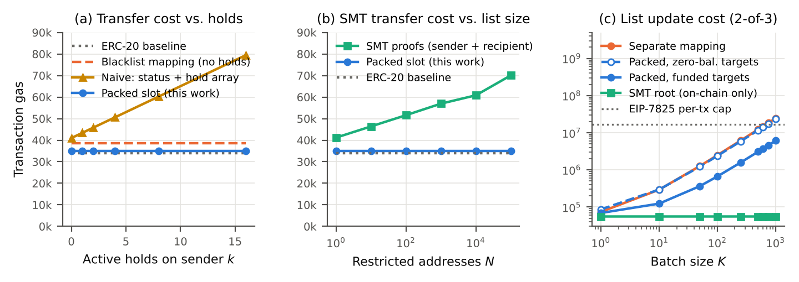

# stablecoin-compliance-controls

Reference implementation, safety tests, and gas benchmarks for **ledger-level compliance controls for payment stablecoins**: block, freeze, reject, hold, seize, and burn, as required of permitted payment stablecoin issuers under the U.S. GENIUS Act (Pub. L. 119-27).

This repository accompanies the paper:

> Meng Wang. *Ledger-Level Compliance Controls for Payment Stablecoins: A Reference Architecture for Block, Freeze, and Reject Capabilities under the GENIUS Act.* Preprint, 2026. <!-- TODO: add arXiv link -->

> [!WARNING]
> Research code. It has **not been audited** and is not intended for production deployment.

## Key results



All values are full transaction gas (base cost + calldata + execution − capped refunds), measured with Foundry in isolated-transaction mode.

| Scenario | Tx gas | vs. baseline |
|---|---:|---:|
| ERC-20 transfer, no compliance logic | 33,980 | — |
| **Transfer, packed design (this work), any number of active holds** | **35,034** | **+3.1%** |
| Transfer, separate blacklist mapping | 38,478 | +13.2% |
| Transfer, separate status + hold array, 0 / 16 holds | 40,975 / 79,487 | +20.6% / +134% |
| Transfer with SMT non-membership proofs, N = 1 / 100,000 | 41,193 / 70,060 | +21% / +106% |

| Compliance action (2-of-3 quorum unless noted) | Tx gas |
|---|---:|
| Freeze, single key (zero-balance account) | 57,633 |
| Freeze, 2-of-4 quorum (zero-balance account) | 85,179 |
| Each additional required signer | ≈ +6,750 |
| Freeze / unfreeze (funded account) | 68,103 / 68,091 |
| Place hold | 91,707 |
| Seize full hold | 73,289 |
| Burn part of a hold | 81,941 |
| Release hold | 64,097 |
| Update SMT root (any batch size) | ≈ 55,450 |

Batch blocking through a separate mapping exceeds the EIP-7825 per-transaction cap (2²⁴ = 16,777,216 gas) at roughly **690 addresses** per transaction. Raw data is in [`results/`](results/).

## Design

| Contract | Role |
|---|---|
| [`EnforcedToken`](src/EnforcedToken.sol) | **Proposed design.** Each account's balance (`uint128`), aggregate held amount (`uint120`), and status (`uint8`) share one storage slot, so a transfer reads compliance state at no extra storage cost. Holds are individually identified records. Seize and burn can only debit an existing hold (two-phase enforcement). Every compliance action extends a hash-chained audit log. |
| [`ComplianceAuthority`](src/ComplianceAuthority.sol) | M-of-N signature quorum over an EIP-712 digest that binds the target, exact calldata, an evidence hash (e.g. a reference to a lawful order), a nonce, and a deadline. It is the only address allowed to change compliance state. |
| [`BaselineToken`](src/BaselineToken.sol) | Plain ERC-20; cost reference. |
| [`BlacklistToken`](src/BlacklistToken.sol) | Comparison: classic blacklist stored in a separate mapping. |
| [`NaiveHoldsToken`](src/NaiveHoldsToken.sol) | Comparison: separate status mapping plus a per-account array of holds summed on every transfer. |
| [`SMTToken`](src/SMTToken.sol) | Comparison: restricted set committed as a depth-160 Sparse Merkle Tree root; every transfer carries compressed non-membership proofs for sender and recipient. |

Account states:

| Status | Outbound | Inbound |
|---|---|---|
| `ACTIVE` (0) | allowed (up to balance − held) | allowed |
| `FROZEN` (1) | blocked | allowed (receive-only) |
| `BLOCKED` (2) | blocked | blocked |

## Safety properties

Proved symbolically with [Halmos](https://github.com/a16z/halmos) (`test/Halmos.t.sol`), and additionally checked by stateful fuzzing (`test/Invariants.t.sol`, 256 runs × depth 64 = 16,384 random calls per invariant) and unit tests (`test/Security.t.sol`):

1. **Hold precedence**: seize and burn debit exactly the requested amount from an existing active hold.
2. **Spendable-balance safety**: an account's held amount equals the sum of its active holds and never exceeds its balance.
3. **Freeze safety**: no user-initiated transfer reduces the balance of a frozen or blocked account.
4. **Supply conservation**: total supply equals minted minus burned-from-holds and equals the sum of balances.
5. **Quorum**: compliance actions require M valid signatures from distinct registered signers. Unit tests cover too few signatures, duplicates, outsiders, replay, tampered calldata, and direct calls.
6. **Log completeness**: every compliance action extends the hash-chained log by exactly one entry.

The Halmos checks make the token's entire storage symbolic, so they quantify over all contract states. Each check assumes the invariant for the accounts a call touches, runs one public function with symbolic arguments and caller, and asserts that the invariant still holds and that state changed exactly as specified, including frame conditions that an arbitrary untouched account and an arbitrary other hold record are unchanged. Every state-changing public function is covered (`transfer`, `transferFrom`, `approve`, `mint`, `setStatus`, `blockBatch`, `placeHold`, `releaseHold`, `seize`, `burnFromHold`), and non-authorized callers are proved to be rejected. Starting from the all-zero initial state, this is an inductive proof over all call sequences for invariants 1–4 and 6; each check also asserts that supply and the compliance log change only as specified (non-compliance calls leave the log untouched). For invariant 5, Halmos proves the token side (no caller other than the authority can change compliance state); signature verification in `ComplianceAuthority` is covered by unit tests only. `blockBatch` is checked for batches of one or two addresses.

`scripts/mutation_check.py` confirms the proofs are not vacuous: it injects seven bugs one at a time (a frozen sender allowed to transfer; seizure not reducing the held amount; burning not reducing supply; holds not bounded by the spendable balance; a seizure that deletes a different hold record; `blockBatch` wiping the account's balance; an ordinary transfer advancing the compliance log) and requires a Halmos counterexample for each.

```bash
pip install halmos==0.3.3
make prove          # forge clean && halmos --contract HalmosProofs  (~30 s)
make mutate         # seven injected bugs, each must yield a counterexample (~2 min)
```

## Repository layout

```
├── src/                      Solidity contracts
├── test/
│   ├── Bench.t.sol           gas benchmarks → results/*.csv
│   ├── Security.t.sol        unit tests (authorization, state semantics, SMT rejection)
│   ├── Invariants.t.sol      stateful invariant fuzzing
│   └── Halmos.t.sol          symbolic proofs of the safety invariants
├── scripts/
│   ├── gen_smt.py            builds SMTs over random restricted addresses → data/
│   ├── plot.py               draws the figure from results/*.csv
│   └── mutation_check.py     non-vacuity check for the Halmos proofs
├── data/                     SMT roots and proofs used by the benchmarks
├── results/                  measured gas (committed; CI checks they reproduce exactly)
├── docs/                     figure used in this README
├── lib/forge-std/            git submodule, pinned to v1.12.0
├── lib/halmos-cheatcodes/    git submodule (symbolic-testing cheatcodes)
├── foundry.toml
└── Makefile
```

## Reproducing

Requirements:
- [Foundry](https://book.getfoundry.sh/getting-started/installation) **v1.5.1**. Install it with `foundryup --install v1.5.1`.
- Python 3.10+ with `pip install -r requirements.txt`. Python is only needed to regenerate SMT data or the figure.

```bash
git clone --recursive https://github.com/AATF-DEV/stablecoin-compliance-controls.git
cd stablecoin-compliance-controls

make test     # unit tests + invariant fuzzing
make bench    # gas benchmarks (forge test --isolate), rewrites results/*.csv
make plot     # figure from results/
make data     # optional: regenerate SMT trees and proofs (~2 min)
```

If you cloned without `--recursive`, run `git submodule update --init` first.

### Measurement notes

- **Compiler and EVM.** solc 0.8.28 with the optimizer on (200 runs) and `evm_version = prague`. None of the Osaka/Fusaka changes alter the cost of the opcodes used here.
- **Isolation mode is required.** `--isolate` makes each top-level call its own transaction with cold storage. Under isolation, Foundry v1.5.1 reports full transaction gas in `vm.lastCallGas().gasTotalUsed`, including the 21,000 base cost, calldata, and the EIP-7623 floor. The harness subtracts refunds, capped at one fifth (EIP-3529).
- **Pinned forge-std.** forge-std is pinned to v1.12.0 because newer versions change the `Vm.Gas` struct, which breaks `lastCallGas()` decoding on Foundry v1.5.1.
- **Steady state.** Each compliance scenario performs one unmeasured warm-up action first, so the authority nonce and log head are already non-zero, as they would be on a live deployment.
- **EIP-7825 cap.** The cap is not enforced by Foundry. It is checked explicitly in the `exceeds_eip7825` column.
- **SMT data.** Restricted addresses are uniformly random from a fixed seed. Proofs are verified in Python before they are written.

## Citation

See [`CITATION.cff`](CITATION.cff), or:

```bibtex
@misc{wang2026ledgercompliance,
  author = {Meng Wang},
  title  = {Ledger-Level Compliance Controls for Payment Stablecoins: A Reference Architecture
            for Block, Freeze, and Reject Capabilities under the {GENIUS} Act},
  year   = {2026},
  note   = {Preprint. Code: https://github.com/AATF-DEV/stablecoin-compliance-controls}
}
```

## License

[MIT](LICENSE). forge-std is included as a submodule under its own MIT/Apache-2.0 license.
